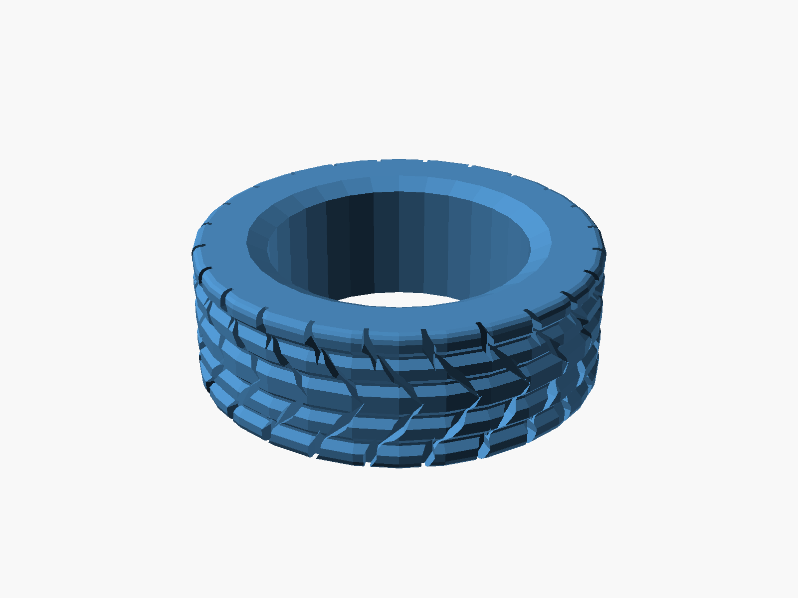
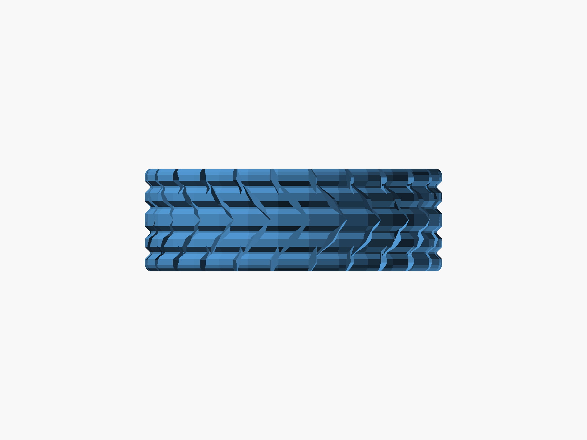
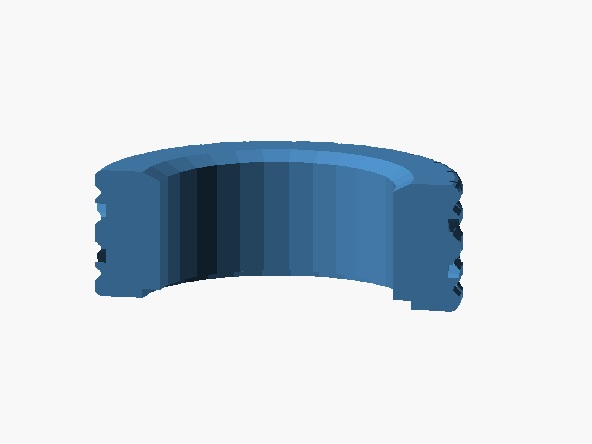

# Parametric TPU Tire for Electric Longboards

[](LICENSE)

A 3D-printable all-terrain tire for split rims, made for electric longboards, mountainboards and DIY off-road vehicles. It is printed in TPU, solid, and clamped between the two halves of the rim. The tread is a hybrid pattern: four continuous longitudinal grooves, a directional V-tread in the centre and shoulder lugs on both edges, for grip on both pavement and light trails.

The model is written in OpenSCAD and is fully parametric. Everything is in a single self-contained `.scad` file. A ready-to-print STL for the default dimensions is in the [`stl/`](stl/) folder.

## 📷 Gallery

<p align="center">
  
  
  
</p>

* **3D view:** the tire rendered in OpenSCAD, with the rounded edges, the longitudinal grooves and the tread cuts.
* **Tread:** the tread seen face-on, with the 4 longitudinal grooves, the V-tread in the centre and the shoulder lugs at the edges, offset by half a step from the V.
* **Cross-section:** the tire cut in half, with the narrower bead on the inside that sits in the rim bed, the longitudinal grooves and the rounded edges.

### Printed prototype

<p align="center">
  
</p>

* The printed TPU tire on a split rim, mounted on an electric longboard.

The prototype was printed from v1.0. v1.1 has exactly the same shape; the changes are listed in the changelog below.

## 📏 Default Dimensions

With the default parameters, the tire has the following specifications (as printed, before shrinkage):

**Tire body**
* **Outer diameter:** 144.4 mm
* **Width:** 50 mm
* **Profile thickness:** 19 mm, from the top of the bead to the tread
* **Edges:** 3 mm rounded edges between the tread and the sidewalls

**Rim fit**
* **Inner diameter:** 92.4 mm, about 91.1 mm after 1.4% shrinkage
* **Bead:** 43 mm wide and 7 mm high, sits in the rim bed between the rim halves
* **Shoulders:** 3.5 mm wide on each side of the bead, inner diameter 106.4 mm

**Tread**
* **Longitudinal grooves:** 4 ×, centred at ±6 mm and ±16 mm from the centre plane, 2.5 mm deep, 6 mm wide at the top and 1 mm at the floor (45° walls)
* **V-tread:** 24 chevrons, each made of two 25 × 4 mm diamond cuts tilted 40°, 4.5 mm deep
* **Shoulder lugs:** 24 pairs of 16 × 4.5 mm diamond cuts tilted 15°, 5 mm deep, offset by half a step (7.5°) from the V-tread

**Material:** about 440 cm³ of solid TPU, roughly 530 g.

## ✨ Features

* **Single Self-Contained File:** all parameters and geometry are in `parametric-tire-electric-longboard.scad`, grouped for the OpenSCAD Customizer.
* **Fully Parametric:** the rim size, tire width and thickness, the groove positions and the size, angle and depth of every tread cut are parameters.
* **All-Terrain Tread:** longitudinal grooves, a directional V-tread and shoulder lugs, built for grip on both pavement and light off-road trails.
* **Support-Free Printing:** the tire prints flat on its side. The longitudinal grooves have 45° walls, and the tread cuts are narrow diamonds whose roofs slope steeply (at most about 49° from vertical), so nothing needs support.
* **Shrinkage Compensation:** the inner diameter is enlarged so the tire shrinks to a tight fit on the rim. The console shows the expected diameter after shrinkage.
* **Input Checks:** the script stops with a clear message if a groove runs into the rounded edge, two grooves overlap, or the tread is deeper than the tire.

## 🚀 Usage

1. Install [OpenSCAD](https://openscad.org/).
2. Open `parametric-tire-electric-longboard.scad`.
3. Adjust the dimensions to your rim (see the table below). The console shows the outer and inner diameter, and the inner diameter after shrinkage.
4. Render the model (**F6**) and export an STL (**F7**).

A ready-made STL for the default dimensions is in the [`stl/`](stl/) folder.

### Key parameters

| Parameter | Default | Description |
|-----------|---------|-------------|
| `rim_radius` | `46.2` | Inner radius of the tire, enlarged for TPU shrinkage (see Fit & Tolerances) |
| `inner_width` | `43` | Width of the rim bed (the bead of the tire) |
| `inner_depth` | `7` | Height of the bead that sits in the rim bed |
| `shrinkage` | `1.4` | Measured TPU shrinkage in %. Only used for the console report. |
| `outer_width` | `50` | Total width of the tire |
| `tire_thickness` | `19` | Thickness of the profile, from the top of the bead to the tread |
| `edge_round` | `3` | Size of the rounded edges |
| `groove_positions` | `[-16, -6, 6, 16]` | Centres of the longitudinal grooves, measured from the centre plane, in ascending order |
| `groove_depth` / `groove_floor_width` | `2.5` / `1` | Depth and floor width of the grooves (the walls are always at 45°) |
| `tread_count` | `24` | Number of tread steps around the tire |
| `v_depth` / `v_offset` / `v_angle` | `4.5` / `9` / `40` | Depth, distance from the centre plane and tilt of the V arms |
| `v_length` / `v_width` | `25` / `4` | Size of a V arm |
| `lug_depth` / `lug_offset` / `lug_angle` | `5` / `20` / `15` | Depth, distance from the centre plane and tilt of the shoulder lugs |
| `lug_length` / `lug_width` | `16` / `4.5` | Size of a shoulder lug |
| `$fn` | `120` | Resolution of the revolved profile |

## 📁 Project Structure

```
parametric-tire-electric-longboard/
├── parametric-tire-electric-longboard.scad   # Parametric tire
├── stl/                                      # Ready-to-print STL (default dimensions)
│   └── parametric-tire-electric-longboard.stl
├── images/                                   # OpenSCAD renders
├── LICENSE                                   # CC BY-NC-SA 4.0
└── README.md
```

## 🖨️ Recommended Print Settings

The tire carries the weight of the rider and the torque of the motor, so it has to be printed solid:
* **Material:** TPU, 85A to 95A (e.g. Rosa3D or similar).
* **Orientation:** flat on its side (the axis vertical), as exported. No supports.
* **Layer height:** 0.20–0.28 mm.
* **Walls:** 4–6 perimeters, for structural strength.
* **Infill:** **100% solid (mandatory).** Sparse infill makes the tire collapse or tear under the weight, the torque and the lateral forces of an electric longboard.
  * *Pro tip for 100% TPU:* use a criss-cross infill pattern (e.g. *Rectilinear* or *Lines* with alternating angles such as 45° and −45°). For the best durability, the infill lines shouldn't stack exactly on top of each other: make sure the slicer shifts the paths slightly sideways on the next layers. This weaves a tight internal structure that is much stronger, and it prevents the material build-up, bulging and nozzle clogs that are common with solid TPU.
* **Cooling:** 100%, which is crucial for the steep roofs of the tread cuts.

## ⚠️ Fit & Tolerances

Flexible materials like TPU shrink slightly as they cool. In my tests, the TPU shrank by exactly **1.4%**:
* **Default fit:** `rim_radius = 46.2` (92.4 mm inner diameter) is already enlarged to compensate, so the tire shrinks to about 91.1 mm and sits tightly on a standard split rim once it has cooled.
* **Other rims:** measure the diameter `D` of your rim bed and set `rim_radius = D / 2 / (1 - shrinkage / 100)`. Different TPU brands can shrink differently, so update `shrinkage` if you measure another value.
* **Too tight or too loose:** adjust `rim_radius` in the model, or scale the STL by 1–2% on the X and Y axes in the slicer. Scaling in the slicer also changes the outer diameter; changing `rim_radius` doesn't change the profile thickness.

## 📝 Changelog

**v1.1** – Refactor
* Code restructured: Customizer groups; the cross-section is built from parameters instead of hand-placed points (`groove_positions` list, `groove_floor_width` with 45° walls, `edge_round`); one `tread_cut()` module used on both sides; `assert()` input checks; console report of the main dimensions
* All tread cuts are set by parameters (`v_*`, `lug_*`) instead of numbers in the code
* Renamed: `groove_count` → `tread_count`, `long_groove_depth` → `groove_depth`. `tread_depth` (3.5) is replaced by `v_depth` (4.5) and `lug_depth` (5), which are the real cut depths (before, the code used `tread_depth + 1` and `tread_depth + 1.5`)
* The shape is unchanged: v1.1 renders exactly the same solid as v1.0 (checked with a boolean difference in both directions)
* STL moved to `stl/` and re-exported (binary, Manifold backend); renders added in `images/`
* CC BY-NC-SA 4.0 license

**v1.0** – First printed version: parametric TPU tire for split rims with a hybrid tread (longitudinal grooves, V-tread and shoulder lugs).

---
*This project is source-available under the [Creative Commons Attribution-NonCommercial-ShareAlike 4.0 International](LICENSE) license (CC BY-NC-SA 4.0). You are free to share and adapt it for non-commercial purposes, as long as you give credit and release your changes under the same license. If you wish to use this project for commercial purposes, please contact me. Developed and designed by Maciej Ślubowski.*
